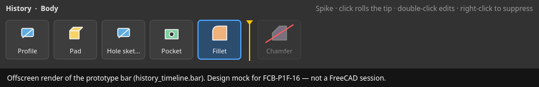
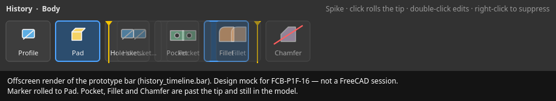
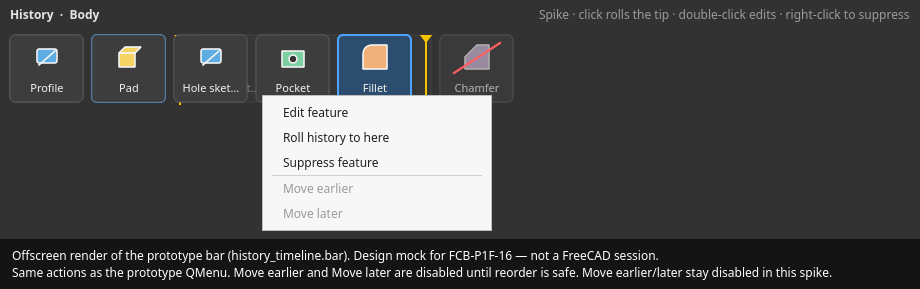
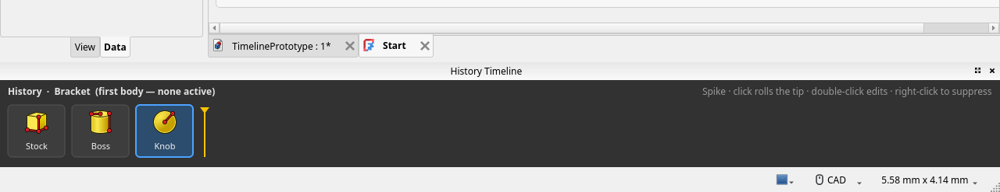

# FCB-P1F-16 — history bar UX

Fusion 360 puts a horizontal feature strip on the bottom of the window: icons in history order, a draggable marker, dimmed features past the marker, click or double-click to edit, and a context menu for suppress and reorder. This note is the BruceWorx version of that strip for one PartDesign body, plus what the prototype actually implements.

The pictures are offscreen renders of `history_timeline.bar.TimelineBar`, the same widget the dock hosts. They are not screenshots of a FreeCAD session. Regenerate them with `docs/mock/render_mock.py`.

## Layout

Bottom dock, full width, about 110px tall. Dark bar (`#323232`) so it reads as a tool strip rather than another tree.

* Header: `History · <body label>`, and a one-line hint of the spike gestures.
* Row: one cell per `Body.Group` child, in that order. Icon, short label, tooltip with `TypeId`, `BaseFeature` name, and state.
* Yellow marker **after** `Body.Tip`. If the tip is `None`, or the tip is the external base feature (not in `Group`), the marker sits at the front and every cell is past it.
* Cells past the tip stay clickable and are drawn at 42% opacity.
* A suppressed feature gets a red slash. That is `Feature.Suppressed`, not "past the tip". A feature can be either, both, or neither.
* The tip cell has a blue border.

Current tip on Fillet. Chamfer is past the tip and suppressed:

Tip rolled back to Pad. Hole sketch, Pocket, Fillet, and Chamfer are past the marker and still in the model:

## Gestures in the prototype

| Gesture | What it does now |
|---|---|
| Click a solid | `Body.Tip = feature`, inside a transaction named "Roll history tip", then recompute. Shows that feature, which is what **Set tip** does. |
| Click a sketch or datum | Refused. Console warning. Same rule as `PartDesign_MoveTip`. |
| Double-click | Selects the object and `Gui.ActiveDocument.setEdit`. PartDesign opens the feature dialog (and switches workbench, which is existing `setEdit` behavior). |
| Right-click → Edit feature | Same as double-click. |
| Right-click → Roll history to here | Same as click. Disabled when the object cannot be the tip. |
| Right-click → Suppress / Unsuppress | `Feature.Suppressed`, transaction, recompute. Disabled when the object has no `Suppressed` property (sketches, VarSets). |
| Move earlier / Move later | Shown and **disabled**. Tooltip: assigning `Group` does not rewrite `BaseFeature`. |

Context menu on Pocket:

The menu card is drawn so the disabled reorder items stay visible. In FreeCAD the dock uses a real `QMenu` with those same labels (`history_timeline/dock.py`).

Which body: `ActiveView.getActiveObject("pdbody")`. If nothing is active, the first `PartDesign::Body` in the document, labeled "(first body — none active)". Empty state if there is no body.

The bar refreshes on document create/change/delete, undo/redo, and document activation. Closing the dock, or unchecking **BruceWorx → History Timeline**, sets `Mod/HistoryTimeline/Enabled` back to false.

## What is intentionally not in the prototype

* Dragging the marker. Click rolls the tip instead. A drag handle is a review question.
* Reorder, including moving a sketch with its feature.
* Nested sketches under the feature that uses them. The row is flat `Group` order, so a sketch sits beside the pad, not inside it.
* One tab per body, or hiding the bar outside the PartDesign workbench.
* A red badge for `Invalid` features.
* An entry for `Body.BaseFeature` or for origin planes.
* FreeCAD's own command icons in the mock PNGs. Inside FreeCAD the cell uses `ViewObject.Icon` when it exists, and the glyph otherwise.

## Prototype inside FreeCAD

`tests/grab_prototype.py` was run under Xvfb with conda-forge FreeCAD 1.1.3 and `-M` pointed at this folder. The document has one body, `Bracket`, containing an additive box (`Stock`), cylinder (`Boss`), and sphere (`Knob`). Nothing had been activated as the PartDesign body, so the header uses the first-body fallback from question 5 in the review list.

The cells use each feature's `ViewObject.Icon`. The yellow marker sits after `Knob`, which is `Body.Tip`. This crop is the bottom of the main window (dock title "History Timeline", the Start page tab above it).

## How this maps onto FreeCAD

The marker is not a new document object. It is `Body.Tip`. Features to the right are not suppressed and are not skipped by recompute. That is the main difference from Fusion, and it is called out in [REVIEW.md](REVIEW.md) question 2. Shipping a bar that *looks* like Fusion while later features still compute is acceptable only if that question is answered in favor of Set tip.
